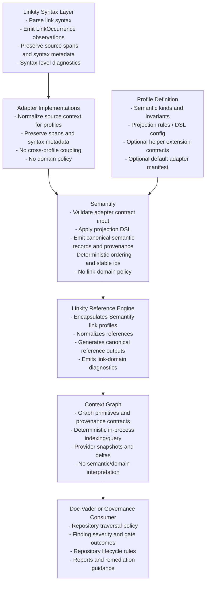
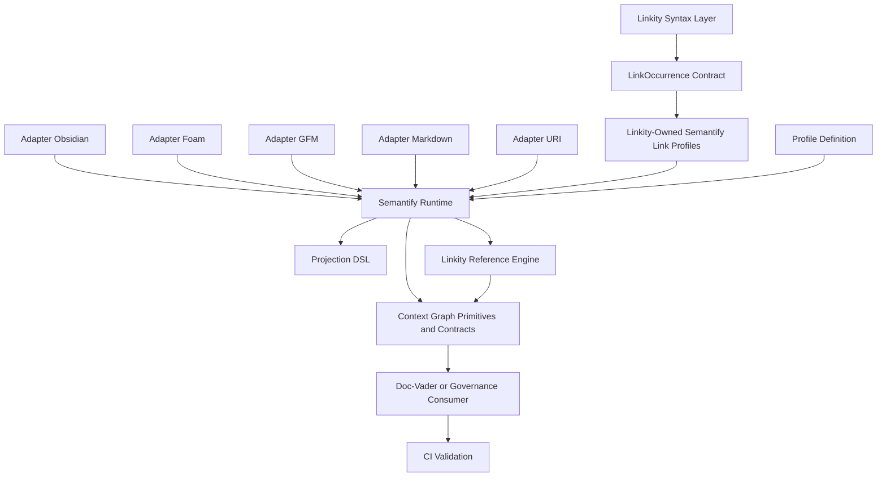
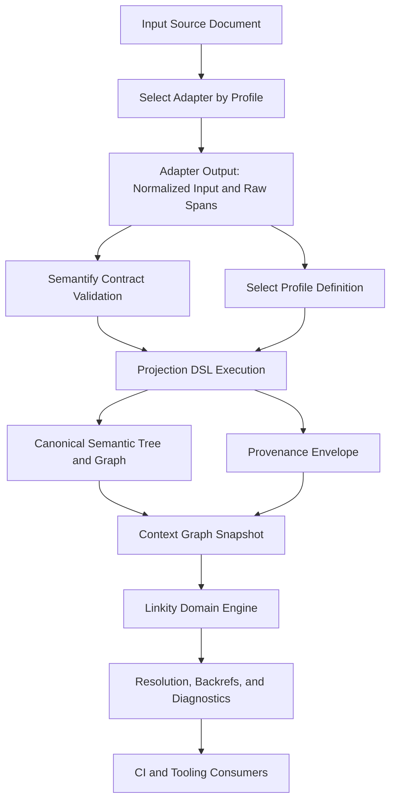
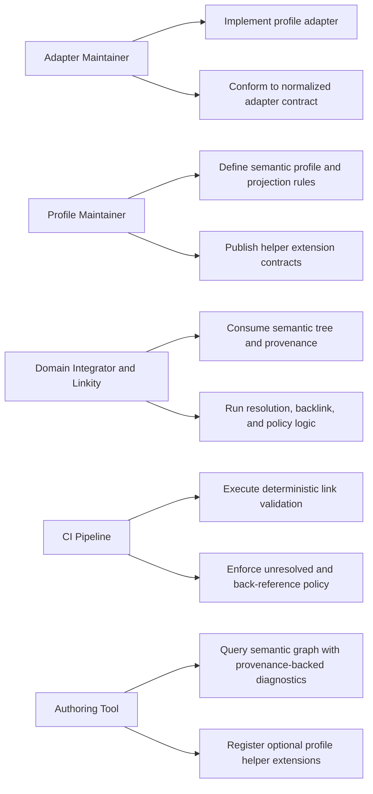
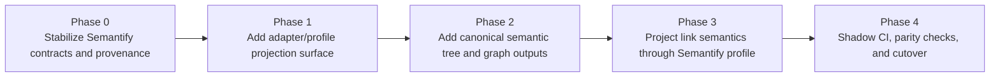

## Purpose

This Architecture Record Document (ARD) defines the scoped boundaries and integration flow for a projection-first architecture across:

1. Discrete syntax adapters/profiles
2. Semantify projection layer
3. Linkity domain logic

The goal is deterministic, reusable semantics with high-fidelity provenance, while keeping domain policy and link behavior outside Semantify.

## Reconciliation Decision

This ADR distinguishes Linkity's syntax extraction layer from Linkity's
Semantify-backed reference normalization layer. Linkity is the product that
encapsulates the Semantify link profiles and uses them internally for canonical
reference normalization and generation.

The appropriate dependency direction is:

```text
Linkity syntax extraction -> Linkity-owned Semantify profiles -> normalized
reference graph output -> Doc-Vader governance evaluation
```

That preserves the reason Semantify was proposed: Linkity should deal in link
semantics without inventing a large Linkity-only canonical semantic syntax. The
Semantify profiles are not optional downstream examples; they are Linkity-owned
profile assets that let Linkity separate syntax handling from semantic projection
inside its own product surface.

The remaining responsibility seam is policy. Linkity may normalize references,
generate canonical reference outputs, and produce link-domain diagnostics, but
Doc-Vader or another governance consumer owns repository traversal policy,
lifecycle policy, severity mapping, and CI gate outcomes.

## Terminology

### Adapter

An adapter is the concrete bridge from a source context implementation into normalized Semantify input.

Adapters own syntax extraction, source-span fidelity, and adapter-local metadata. They may wrap parser output, visitor utilities, language-service facts, schema analyzers, URI scanners, or other source-context implementations. They do not own canonical semantic meaning beyond emitting normalized observations that a profile can project.

Examples:

1. TemplJS template adapter
2. Markdown link adapter
3. Obsidian wikilink adapter
4. Foam note-reference adapter
5. URI adapter
6. JSON Schema adapter

### Profile

A profile is the client-facing semantic package for a use case. It owns the semantic definition, projection rule set, and optional helper-extension contracts that make the semantic output reusable by downstream clients.

Profiles may publish a default adapter manifest, but adapter implementations are replaceable and are not intrinsic to the profile. This preserves the ability to feed one semantic definition from multiple syntaxes or source systems.

In short:

```text
Adapter = source context -> normalized adapter output
Profile = semantic definition + projection rules + helper extension contracts
Profile bundle = profile + default adapters + default helpers
```

### Helper Extensions

Helper extensions are optional client-facing affordances layered over canonical semantics. Examples include candidate providers, definition resolvers, hover renderers, and diagnostic planners.

Helper extensions are not part of Semantify core projection. Semantify may expose extension points and pass graph/provenance output to registered helpers, but editor text, CI severity, pass/fail policy, and product-specific fallback behavior remain outside core Semantify.

### Context Graph

Context Graph owns graph primitives and deterministic in-process graph contracts. It may own simplified primitive names such as `Node`, `Edge`, `GraphSnapshot`, `GraphDelta`, and `ProvenanceEnvelope`.

Context Graph is not a semantic interpreter and is not intended to become a graph database. It stores, indexes, snapshots, and queries graph facts emitted by Semantify or other providers. If deeper graph traversal or persistence becomes necessary, add an adapter to an existing graph engine rather than expanding Context Graph into a database.

## Architectural Scope and Boundaries

### System Boundaries



### Ownership Matrix

```text
Capability                                      Owner
----------------------------------------------  -------------------------------
Link syntax extraction                          Linkity syntax layer
Link occurrence contract and source spans        Linkity syntax layer
Syntax-level link diagnostics                   Linkity syntax layer
Link profile ownership                          Linkity product
Semantic definition and projection rules         Linkity-owned Semantify profiles
Projection mapping and semantic normalization   Semantify runtime (+ Linkity profile rules)
Provenance emission and lineage                 Semantify
Graph primitives and provenance contracts        Context Graph
Cross-profile semantic contract                 Semantify (+ Context Graph)
Canonical reference generation                  Linkity reference engine
Backlink and inbound graph facts                Linkity output and Context Graph consumers
Traversal policy and governance findings         Doc-Vader or governance consumer
CI policy gating and rule outcomes              Doc-Vader or governance consumer
```

## Dependency Graph



### Dependency Rules

1. Linkity's syntax layer depends on local parser code and link occurrence types only.
2. Linkity's reference engine depends on Semantify runtime/profile contracts and
   Linkity-owned profile assets for normalization and generation.
3. Linkity must not depend on Doc-Vader governance policy.
4. Adapters depend on local source-context implementation and adapter contract only.
5. Profiles depend on semantic contract, projection rule schema, and helper-extension contracts.
6. Semantify depends on adapter contract, profile projection rules, projection DSL, and context/provenance contracts.
7. Context Graph depends on graph primitive contracts only and does not interpret semantic domains.
8. Governance consumers depend on graph snapshots and semantic records through adapters, not parser internals.
9. No adapter depends on another adapter.

## Flow Chart



## Use Case Diagram



## Migration Scope by Component

### 1. Adapter and Profile Implementations

Existing capabilities:

1. Profile-specific parsing primitives already exist for major link forms (for example wikilink, markdown link, and raw URI extraction in Linkity).
2. Per-profile parsing can be developed and tested independently.

New development scope:

1. Define and enforce a normalized adapter output contract for all profiles.
2. Add adapters for each target profile with parity guarantees (Foam, Obsidian, GFM, Markdown, URI).
3. Standardize raw span and syntax metadata emission across adapters.
4. Define profile contracts as semantic definitions plus projection rule sets and helper-extension contracts.
5. Allow profiles to publish default adapter manifests without coupling Semantify core to adapter implementations.

### 2. Semantify

Existing capabilities:

1. Service orchestration and semantic API contract patterns are established.
2. Typed semantic outputs exist for current templating-oriented use cases.

New development scope:

1. Introduce projection-first runtime semantics that consume normalized adapter input.
2. Implement a projection DSL for declarative mapping and deterministic semantic shaping.
3. Add first-class provenance envelopes to output contracts.
4. Keep Semantify policy-agnostic with no link-domain CI rules.
5. Move editor/task-oriented helpers behind profile extension hooks instead of core Semantify contracts.

### 3. Context Graph

Existing capabilities:

1. Context graph style public API constraints already fit the target boundary.
2. Deterministic in-process graph snapshot/query behavior exists as a foundation.

New development scope:

1. Own graph primitive contracts (`Node`, `Edge`, `GraphSnapshot`, `GraphDelta`, `ProvenanceEnvelope`).
2. Require provenance on projected graph nodes and edges.
3. Keep indexing/query support deterministic and in-process.
4. Avoid semantic-domain interpretation and graph-database scope creep.

### 4. Linkity

Existing capabilities:

1. Link extraction and visitor-style utilities are in place.
2. Foundational parser coverage and tests already exist for baseline formats.

New development scope:

1. Stabilize a small LinkOccurrence contract with raw text, normalized target,
   syntax kind, source spans, and syntax metadata.
2. Keep syntax-level parser diagnostics in the Linkity syntax layer.
3. Encapsulate Linkity-owned Semantify profiles for canonical reference
   normalization and generation.
4. Emit deterministic reference outputs with provenance suitable for Context
   Graph and governance consumers.
5. Leave repository traversal policy, lifecycle rules, severity mapping, and CI
   gate outcomes to Doc-Vader or another governance consumer.

## Migration Phases



### Phase 0: Stabilize Contracts

Existing capabilities:

1. Core semantic service orchestration already exists.
2. Current typed APIs provide a baseline for public contract shape.

New development scope:

1. Formalize Semantify adapter/projection contracts.
2. Add provenance as a required output envelope.
3. Establish deterministic ordering and schema-versioning rules.

### Phase 1: Adapter and Profile Surface

Existing capabilities:

1. Linkity already has small, syntax-specific parsing primitives that can serve as reference behavior.
2. Profile-specific parsing can be exercised independently in tests.

New development scope:

1. Implement discrete adapters for Obsidian, Foam, GFM, Markdown, and URI profiles.
2. Ensure each adapter emits normalized input plus raw spans.
3. Keep profile implementations isolated and replaceable.
4. Define profile specs as semantic definitions with projection rule sets and optional helper extensions.
5. Publish profile bundles only as convenience packaging; Semantify core must accept profile specs without default adapters.

### Phase 2: Semantic Projection Runtime

Existing capabilities:

1. A semantic service surface already exists in Semantify.
2. Context-graph style public API constraints already fit the target boundary.

New development scope:

1. Add a projection DSL for adapter-to-semantic mapping.
2. Emit canonical semantic tree and graph structures.
3. Attach provenance to every semantic node and edge.
4. Load profile helper-extension metadata without executing product-specific policy in Semantify core.

### Phase 3: Link Semantic Projection

Existing capabilities:

1. Link extraction, visitor utilities, and parser tests already exist in Linkity.

New development scope:

1. Stabilize Linkity's link occurrence output as input to Linkity-owned
   Semantify profiles.
2. Use those profiles inside Linkity for canonical reference normalization and
   generation.
3. Publish graph facts for Context Graph consumers.
4. Leave traversal policy and CI gate outcomes to Doc-Vader or another governance consumer.

### Phase 4: Shadow CI and Cutover

Existing capabilities:

1. Current doc-vader validation logic provides a baseline parity target.

New development scope:

1. Run Semantify/Linkity in shadow mode alongside current validators.
2. Compare unresolved and inbound results against existing CI output.
3. Cut over once parity and determinism are demonstrated.

### Phase Scope Summary

```text
Phase   Main Outcome                               Existing Capability Used
-----   ---------------------------------------    -----------------------------
P0      Contract stability                         Semantify service surface
P1      Profile adapters                           Linkity syntax primitives
P2      Semantic projection runtime                 Context-graph boundary model
P3      Link semantic projection                   Linkity parser and utilities
P4      CI parity and cutover                       doc-vader validation baseline
```

## Projection DSL Scope

Semantify DSL is in scope for:

1. Mapping adapter tokens/nodes to canonical semantic node and edge shapes.
2. Normalization and canonicalization of non-policy semantic fields.
3. Deterministic ordering and stable identity generation.
4. Structured projection diagnostics.

Semantify DSL is out of scope for:

1. Link-domain policy decisions (severity, gating, archival criteria).
2. Product-specific fallback heuristics.
3. CI pass/fail decision logic.

### DSL Adoption Target

The target state is declarative projection. Adoption should be phased to avoid freezing a weak DSL before enough profiles prove the required operators:

1. Contract-first: stabilize `AdapterOutput`, graph nodes/edges, provenance, and projection rule metadata.
2. Typed registry: projection rules are declared with stable IDs and versions, but may initially execute typed TypeScript functions.
3. Declarative subset: selectors, field mapping, normalization, canonicalization, stable ID generation, and simple synthesis.
4. Full DSL: expand only after real profiles demonstrate recurring rule patterns.

## Provenance as First-Class Concept

Provenance is required at projection output and should be first-class in context graph contracts.

Minimum provenance envelope:

1. Provider/adapter id and version
2. Source document identity
3. Source span (offset range, optional line/column)
4. Transformation lineage (projection step id)
5. Confidence/ambiguity marker
6. Stable semantic node/edge id linkage

Source spans use start-inclusive, end-exclusive offsets. This matches common editor/LSP range conventions and avoids recurring off-by-one ambiguity.

## Determinism and Contract Guarantees

Semantify guarantees:

1. Same input + same adapter version + same DSL version => byte-stable semantic output ordering.
2. Public signatures expose package-owned types only.
3. Output payloads remain dependency-leak-safe and JSON-compatible.

## Non-Goals

1. Building a full document AST for all syntaxes in Semantify.
2. Embedding link-domain resolution engines in Semantify.
3. Coupling adapter implementations to one another.

## Acceptance Criteria for This Architecture

1. A new profile adapter can be added without changing Semantify core contracts.
2. Linkity encapsulates Semantify profiles for core reference normalization and generation.
3. Provenance data remains sufficient to trace every diagnostic to source spans.
4. CI results are deterministic across repeated governance runs.

---

## Semantic Contracts (TypeScript Definitions)

This section defines the minimal contract set for projection-based semantic linking. All contracts are JSON-serializable, dependency-leak-safe, and versioned for stability.

### Schema Versioning

All contracts use semantic versioning for schema compatibility:

- `schemaVersion: "1.0.0"` — Initial stable release
- Breaking changes increment MAJOR; new optional fields increment MINOR

### Provenance Envelope

```typescript
/**
 * ProvenanceEnvelope: High-fidelity source and transformation tracking.
 * Required on every SemanticNode and SemanticEdge output.
 *
 * Guarantees:
 * - Traceability to original source span
 * - Deterministic transformation lineage
 * - JSON serializable with no external dependencies
 */
interface ProvenanceEnvelope {
  schemaVersion: "1.0.0";

  /** Adapter/profile identifier (e.g., "wikilink", "markdown-link", "raw-url") */
  adapterId: string;

  /** Adapter semantic version (e.g., "1.0.0") */
  adapterVersion: string;

  /** Source document identity (file path, URI, or content hash) */
  sourceDocId: string;

  /**
   * Source character span in original document.
   * Start-inclusive and end-exclusive; e.g., { start: 42, end: 90 }
   * captures chars 42-89.
   */
  sourceSpan: {
    start: number;
    end: number;
  };

  /**
   * Optional line and column for human-readable diagnostics.
   * Line and column are 1-indexed; undefined if unavailable.
   */
  sourceLoc?: {
    line: number;
    column: number;
  };

  /**
   * Projection rule ID that produced this semantic node.
   * Used for tracing through DSL transformations.
   */
  projectionRuleId: string;

  /**
   * Ambiguity or confidence marker.
   * "definite" => canonical mapping with no heuristics.
   * "heuristic" => fallback or recovered mapping.
   * "synthetic" => generated (e.g., implicit backlink).
   */
  confidence: "definite" | "heuristic" | "synthetic";

  /**
   * Stable semantic node or edge ID this provenance refers to.
   * Used to trace back from semantic output to source.
   */
  targetSemanticId: string;
}
```

**Usage Example:**

```typescript
const exampleProvenance: ProvenanceEnvelope = {
  schemaVersion: "1.0.0",
  adapterId: "wikilink",
  adapterVersion: "1.0.0",
  sourceDocId: "docs/getting-started.md",
  sourceSpan: { start: 123, end: 156 },
  sourceLoc: { line: 10, column: 5 },
  projectionRuleId: "wikilink.link.to-semantic-node",
  confidence: "definite",
  targetSemanticId: "semantic-node-abc123",
};
```

---

### Projection Rule Schema

```typescript
/**
 * ProjectionRule: Declarative mapping from adapter input to semantic output.
 * Stored in DSL configuration; not passed at runtime, but its ID is.
 *
 * Guarantees:
 * - Deterministic transformation (same input always yields same output)
 * - No domain policy embedded (normalization only)
 * - Composable and versioned for incremental extension
 */
interface ProjectionRule {
  schemaVersion: "1.0.0";

  /** Unique identifier within adapter/profile DSL set */
  id: string;

  /** Human-readable name for debugging and logs */
  name: string;

  /** Semantic version of rule logic */
  version: string;

  /**
   * Source node kind from adapter grammar
   * (e.g., "wikilink.link", "markdown.link", "uri.raw")
   */
  sourceNodeKind: string;

  /**
   * Target semantic node kind produced
   * (e.g., "semantic.link", "semantic.reference", "semantic.target")
   */
  targetSemanticKind: string;

  /**
   * Determinism guarantee.
   * "strict" => identical transformation always.
   * "order-preserving" => multiple outputs in stable order.
   */
  deterministicBehavior: "strict" | "order-preserving";

  /**
   * Transformation steps (declarative).
   * Order matters; steps applied in sequence.
   */
  transformationSteps: Array<{
    /** Step kind: "extract", "normalize", "canonicalize", "enrich", "synthesize" */
    kind: "extract" | "normalize" | "canonicalize" | "enrich" | "synthesize";

    /** Step description for documentation and debugging */
    description: string;

    /** Input field path (JSONPath-like; e.g., "$.url", "$.text") */
    inputPath?: string;

    /** Output field path (e.g., "$.semanticNodeId", "$.targetUri") */
    outputPath?: string;

    /** Optional constraints or validation rules */
    constraints?: Record<string, unknown>;
  }>;
}
```

**Usage Example:**

```typescript
const exampleProjectionRule: ProjectionRule = {
  schemaVersion: "1.0.0",
  id: "wikilink.link.to-semantic-node",
  name: "Wikilink to Semantic Link Node",
  version: "1.0.0",
  sourceNodeKind: "wikilink.link",
  targetSemanticKind: "semantic.link",
  deterministicBehavior: "strict",
  transformationSteps: [
    {
      kind: "extract",
      description: "Extract target path from wikilink",
      inputPath: "$.target",
      outputPath: "$.rawTarget",
    },
    {
      kind: "normalize",
      description: "Normalize path separators",
      inputPath: "$.rawTarget",
      outputPath: "$.normalizedTarget",
    },
    {
      kind: "canonicalize",
      description: "Generate stable semantic node ID",
      inputPath: "$.normalizedTarget",
      outputPath: "$.semanticNodeId",
    },
  ],
};
```

---

### Profile Definition

```typescript
/**
 * ProfileDefinition: Client-facing semantic package loaded by Semantify.
 *
 * Guarantees:
 * - Defines semantic kinds and projection rules without binding to one adapter
 * - May advertise helper extensions, but does not execute editor or CI policy
 * - May recommend adapters through a manifest while preserving replaceability
 */
interface ProfileDefinition {
  schemaVersion: "1.0.0";

  /** Stable client-facing profile identifier, e.g. "linkity.notes" */
  id: string;

  /** Profile semantic version */
  version: string;

  /** Semantic node and edge kind definitions accepted by this profile */
  semanticKinds: Array<{
    kind: string;
    description?: string;
    requiredContentFields?: string[];
  }>;

  /** Projection rules used to map adapter output into canonical graph output */
  projectionRules: ProjectionRule[];

  /** Optional helper contracts exposed to clients for reuse */
  helperExtensions?: ProfileHelperExtension[];

  /** Optional default adapter manifest; adapters remain replaceable */
  defaultAdapters?: Array<{
    adapterId: string;
    adapterVersionRange: string;
    sourceNodeKinds: string[];
  }>;
}

/**
 * ProfileHelperExtension: Optional client affordance over semantic output.
 *
 * Semantify core exposes this metadata and stable invocation points, but
 * product/editor/CI packages own concrete rendering, severity, and policy.
 */
interface ProfileHelperExtension {
  schemaVersion: "1.0.0";
  id: string;
  kind:
    | "candidate-provider"
    | "definition-resolver"
    | "hover-renderer"
    | "diagnostic-planner";
  consumesSemanticKinds: string[];
  description?: string;
}
```

---

### Semantic Node

```typescript
/**
 * SemanticNode: Canonical representation of a link node.
 * Produced by Semantify projection and consumed by Linkity.
 *
 * Guarantees:
 * - Stable ID generation (deterministic across runs)
 * - Provenance first-class (every node carries source identity)
 * - JSON serializable with no external dependencies
 * - Immutable after creation; extension via optional fields only
 */
interface SemanticNode {
  schemaVersion: "1.0.0";

  /**
   * Stable, deterministic ID for this semantic node.
   * Format: URI or base62-encoded hash of stable inputs.
   * Same inputs always produce same ID.
   */
  id: string;

  /**
   * Semantic node kind.
   * Examples: "link", "reference", "target", "anchor", "metadata"
   */
  kind: string;

  /**
   * Primary content/payload for this node.
   * Examples: { url: "https://..." }, { path: "docs/page.md" }
   * Domain interpretation deferred to Linkity.
   */
  content: Record<string, unknown>;

  /**
   * Provenance tracking this node to source.
   * Always present; required for diagnostics.
   */
  provenance: ProvenanceEnvelope;

  /**
   * Optional alias or label (e.g., display text for a link).
   * Not required; policy-neutral.
   */
  alias?: string;

  /**
   * Optional metadata for Linkity or domain-specific extension.
   * Structure is open; unknown fields preserved for forward compatibility.
   */
  metadata?: Record<string, unknown>;

  /**
   * Optional tags for classification or filtering.
   * Examples: ["external", "fragment", "auto-generated"]
   */
  tags?: string[];
}
```

**Usage Example:**

```typescript
const exampleSemanticNode: SemanticNode = {
  schemaVersion: "1.0.0",
  id: "semantic-link-abc123",
  kind: "link",
  content: {
    target: "docs/guide.md",
    displayText: "Getting Started",
  },
  provenance: {
    schemaVersion: "1.0.0",
    adapterId: "wikilink",
    adapterVersion: "1.0.0",
    sourceDocId: "docs/index.md",
    sourceSpan: { start: 123, end: 145 },
    sourceLoc: { line: 8, column: 3 },
    projectionRuleId: "wikilink.link.to-semantic-node",
    confidence: "definite",
    targetSemanticId: "semantic-link-abc123",
  },
  alias: "Getting Started",
  tags: ["internal-link"],
};
```

---

### Semantic Edge

```typescript
/**
 * SemanticEdge: Canonical representation of a relationship between nodes.
 * Produced by Semantify projection and consumed by Linkity.
 *
 * Guarantees:
 * - Stable ID generation (deterministic across runs)
 * - Provenance first-class (every edge carries source identity)
 * - JSON serializable with no external dependencies
 * - Directional but allows optional backref synthesis
 */
interface SemanticEdge {
  schemaVersion: "1.0.0";

  /**
   * Stable, deterministic ID for this semantic edge.
   * Format: URI or base62-encoded hash of stable inputs.
   */
  id: string;

  /**
   * Source node ID (start of relationship).
   * Must reference an existing SemanticNode.id.
   */
  sourceNodeId: string;

  /**
   * Target node ID (end of relationship).
   * Must reference an existing SemanticNode.id.
   */
  targetNodeId: string;

  /**
   * Edge type/role name.
   * Examples: "links-to", "references", "defined-by", "backref"
   */
  role: string;

  /**
   * Edge directionality.
   * "forward" => explicit source → target relationship.
   * "bidirectional" => relationship goes both ways.
   * "implicit" => computed/synthesized relationship.
   */
  direction: "forward" | "bidirectional" | "implicit";

  /**
   * Provenance tracking this edge to source.
   * Always present; required for diagnostics.
   */
  provenance: ProvenanceEnvelope;

  /**
   * Optional weight or confidence score.
   * Useful for ranking or filtering by Linkity.
   */
  weight?: number;

  /**
   * Optional metadata for Linkity extension.
   * Examples: { fragmentIdentifier: "section-1", label: "See Also" }
   * Structure is open; unknown fields preserved.
   */
  metadata?: Record<string, unknown>;

  /**
   * Optional tags for classification.
   * Examples: ["fragment", "backref", "inbound"]
   */
  tags?: string[];
}
```

**Usage Example:**

```typescript
const exampleSemanticEdge: SemanticEdge = {
  schemaVersion: "1.0.0",
  id: "semantic-edge-xyz789",
  sourceNodeId: "semantic-link-abc123",
  targetNodeId: "semantic-target-def456",
  role: "links-to",
  direction: "forward",
  provenance: {
    schemaVersion: "1.0.0",
    adapterId: "wikilink",
    adapterVersion: "1.0.0",
    sourceDocId: "docs/index.md",
    sourceSpan: { start: 123, end: 145 },
    sourceLoc: { line: 8, column: 3 },
    projectionRuleId: "wikilink.link.to-semantic-edge",
    confidence: "definite",
    targetSemanticId: "semantic-edge-xyz789",
  },
  weight: 1.0,
  tags: ["internal-link"],
};
```

---

### Adapter Contract (Input to Semantify)

```typescript
/**
 * AdapterOutput: Normalized output from any profile adapter.
 * Input contract for Semantify projection.
 *
 * Guarantees:
 * - Profile-specific parsing handled by adapter; Semantify receives normalized shape
 * - Source spans are always preserved
 * - No cross-adapter coupling; each adapter is independent
 */
interface AdapterOutput {
  schemaVersion: "1.0.0";

  /** Adapter identifier (e.g., "wikilink", "markdown", "foam", "obsidian") */
  adapterId: string;

  /** Adapter version (semantic) */
  adapterVersion: string;

  /** Source document identity */
  sourceDocId: string;

  /** Parsed nodes from source (adapter-specific shape, but must include spans) */
  nodes: Array<{
    kind: string; // e.g., "wikilink.link", "markdown.link", "uri.raw"
    sourceSpan: { start: number; end: number };
    content: Record<string, unknown>; // e.g., { target, displayText }
  }>;

  /** Diagnostic messages from parsing phase (optional) */
  diagnostics?: Array<{
    severity: "info" | "warning" | "error";
    message: string;
    span?: { start: number; end: number };
  }>;
}
```

---

### Contract Stability Roadmap

| Component          | P0 Status | P1+ Evolution                                 |
| ------------------ | --------- | --------------------------------------------- |
| ProvenanceEnvelope | Locked    | Optional new fields (confidence values, etc.) |
| ProjectionRule     | Locked    | New step kinds; new transformation operators  |
| SemanticNode       | Locked    | Optional metadata fields; new tags            |
| SemanticEdge       | Locked    | Optional metadata fields; new roles           |
| AdapterOutput      | Locked    | Optional diagnostics; new node kinds          |

**Backward Compatibility Rule:** All new fields are optional. Older versions can ignore unknown fields. Breaking changes require MAJOR version bump and migration plan.

---

## Integration with Phase Scope

### Phase 0: Contracts Stabilized

- ProvenanceEnvelope, ProjectionRule, SemanticNode, SemanticEdge, and AdapterOutput contracts are finalized and locked for P1+.
- Versioning and stability guarantees are established.

### Phase 1: Adapter Implementation

- Adapters conform to AdapterOutput contract.
- Each adapter emits normalized nodes with sourceSpan and content fields.

### Phase 2: Projection Runtime

- Semantify consumes AdapterOutput.
- DSL execution generates SemanticNode and SemanticEdge with ProvenanceEnvelope on each.
- ProjectionRuleId is tracked and included in provenance.

### Phase 3–4: Linkity and CI

- Linkity consumes semantic tree and provenance.
- Provenance enables tracing diagnostics back to source spans.
- Determinism of Semantify + Linkity outputs enables CI parity validation.
