This document provides a comprehensive analysis of tokenizers, parsers, Abstract Syntax Trees (AST), and Intermediate Representations (IR), including their inverse operations, relevant design patterns, and their current and future roles in the Linkity project.

## Table of Contents

- [Overview](#overview)
- [Conceptual Framework](#conceptual-framework)
- [Processing Pipeline](#processing-pipeline)
- [Detailed Comparison](#detailed-comparison)
- [Inverse Operations](#inverse-operations)
- [Design Patterns](#design-patterns)
- [Current Role in Linkity](#current-role-in-linkity)
- [Future Considerations](#future-considerations)

## Overview

```mermaid
flowchart LR
    subgraph Forward["Forward Processing (Analysis)"]
        direction LR
        Text["Text/Source Code"] --> Tokenizer
        Tokenizer --> Tokens["Token Stream"]
        Tokens --> Parser
        Parser --> AST["Abstract Syntax Tree"]
        AST --> IR["Intermediate Representation"]
    end
    
    subgraph Reverse["Reverse Processing (Synthesis)"]
        direction RL
        IR2["Intermediate Representation"] --> CodeGen["Code Generator"]
        CodeGen --> AST2["AST Traversal"]
        AST2 --> Printer["Pretty Printer"]
        Printer --> Output["Generated Code"]
    end
    
    Forward ~~~ Reverse
    
    style Text fill:#e1f5ff
    style Tokens fill:#fff4e1
    style AST fill:#f0e1ff
    style IR fill:#e1ffe8
    style Output fill:#ffe1e8
```

The compilation/parsing pipeline consists of several distinct stages, each with specific responsibilities and outputs. Understanding these stages is crucial for making informed architectural decisions.

## Conceptual Framework

### Core Concepts

| Concept | Primary Purpose | Output | Abstraction Level |
| ------- | -------------- | ------ | ----------------- |
| **Tokenizer/Lexer** | Convert raw text into meaningful units | Token stream | Low (character → token) |
| **Parser** | Build structure from tokens | Parse tree or AST | Medium (tokens → structure) |
| **AST** | Represent syntactic structure | Tree data structure | High (abstract syntax) |
| **IR** | Enable analysis & transformation | Optimized representation | Variable (domain-specific) |

### Key Distinctions

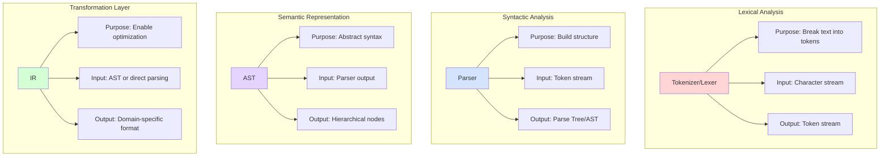

## Processing Pipeline

### Forward Flow: Analysis

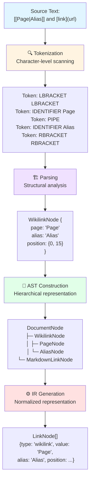

### Reverse Flow: Synthesis

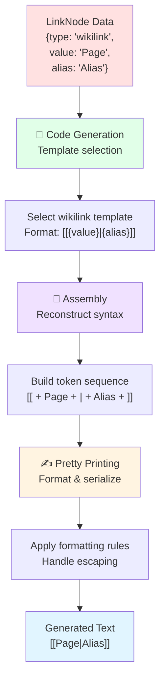

## Detailed Comparison

### Tokenizer/Lexer

**Purpose:** Convert raw text into a stream of tokens (lexemes with metadata)

**Characteristics:**

- Operates at the **character level**
- Handles whitespace, comments, and insignificant syntax
- Produces a flat, sequential output
- Stateless or minimal state (e.g., tracking position)
- Fast and memory-efficient

**Example Input → Output:**

```javascript
// Input text
"See [[Page|Alias]] and [text](url)"

// Token stream output
[
  { type: 'TEXT', value: 'See ', start: 0, end: 4 },
  { type: 'LBRACKET', value: '[', start: 4, end: 5 },
  { type: 'LBRACKET', value: '[', start: 5, end: 6 },
  { type: 'IDENTIFIER', value: 'Page', start: 6, end: 10 },
  { type: 'PIPE', value: '|', start: 10, end: 11 },
  { type: 'IDENTIFIER', value: 'Alias', start: 11, end: 16 },
  { type: 'RBRACKET', value: ']', start: 16, end: 17 },
  { type: 'RBRACKET', value: ']', start: 17, end: 18 },
  // ... more tokens
]
```

**Common Patterns:**

- **Regular expressions** (simple tokenizers)
- **State machines** (finite automata)
- **Scanner pattern** (iterator-based)

**Linkity Context:**

- `src/utils/tokenize.ts` implements a **minimal tokenizer** for wikilinks
- Supports variant-specific features (Obsidian, Foam, etc.)
- Returns `WikilinkToken[]` with position tracking

### Parser

**Purpose:** Build hierarchical structure from a token stream

**Characteristics:**

- Operates at the **token level**
- Enforces grammar rules and syntax
- Produces a tree structure (parse tree or AST)
- May be stateful (tracking context, scope)
- More complex than tokenizers

**Example Input → Output:**

```javascript
// Input: Token stream (from above)
// Output: Structured nodes
{
  type: 'WikilinkNode',
  page: 'Page',
  alias: 'Alias',
  position: { start: 4, end: 18 }
}
```

**Common Patterns:**

- **Recursive descent** (hand-written, common for simple grammars)
- **LL/LR parsing** (table-driven, for complex grammars)
- **PEG parsers** (Parsing Expression Grammars)
- **Combinator parsers** (functional composition)

**Linkity Context:**

- `src/parsers/wikilink.ts`, `markdown.ts`, `url.ts` are **simple parsers**
- Use regex-based pattern matching (simplified parsing)
- Return `LinkNode[]` directly (bypassing full AST)
- Focus on **link extraction** rather than full document parsing

### Abstract Syntax Tree (AST)

**Purpose:** Represent the syntactic structure of code/text in a tree form

**Characteristics:**

- **Hierarchical** data structure (tree of nodes)
- Abstracts away syntactic details (e.g., punctuation, keywords)
- Preserves semantic meaning and structure
- Enables traversal, analysis, and transformation
- May include position information for error reporting

**Example Structure:**

```javascript
// AST for: "See [[Page|Alias]] and [text](url)"
{
  type: 'Document',
  children: [
    {
      type: 'Paragraph',
      children: [
        { type: 'Text', value: 'See ' },
        {
          type: 'Wikilink',
          page: { type: 'PageReference', value: 'Page' },
          alias: { type: 'Text', value: 'Alias' },
          position: { start: 4, end: 18 }
        },
        { type: 'Text', value: ' and ' },
        {
          type: 'MarkdownLink',
          text: { type: 'Text', value: 'text' },
          url: { type: 'URL', value: 'url' },
          position: { start: 23, end: 33 }
        }
      ]
    }
  ]
}
```

**Common Patterns:**

- **Visitor pattern** (traversal and transformation)
- **Composite pattern** (uniform tree node interface)
- **Builder pattern** (incremental AST construction)

**Linkity Context:**

- **Not currently implemented** (intentional MVP decision)
- Current architecture is **link-centric**, not document-centric
- Potential future addition if needed for:
  - Full document parsing
  - Context-aware transformations
  - Plugin/visitor APIs for complex workflows

### Intermediate Representation (IR)

**Purpose:** Provide a normalized, domain-specific representation for analysis and transformation

**Characteristics:**

- **Domain-specific** (tailored to use case)
- May be **lower-level** (closer to machine code) or **higher-level** (semantic)
- Optimized for specific operations (e.g., type checking, optimization)
- Often multiple IRs in a compilation pipeline
- Decouples frontend (parsing) from backend (code generation)

**Example in Compiler Context:**

```javascript
// High-level IR (SSA - Static Single Assignment)
{
  type: 'BasicBlock',
  instructions: [
    { op: 'LOAD', var: 'x', value: 5 },
    { op: 'LOAD', var: 'y', value: 10 },
    { op: 'ADD', result: 'z', operands: ['x', 'y'] },
    { op: 'RETURN', value: 'z' }
  ]
}
```

**Example in Linkity Context:**

```javascript
// LinkNode as IR: normalized link representation
{
  type: 'wikilink',       // Normalized type
  value: 'Page',          // Core reference
  alias: 'Alias',         // Optional metadata
  position: { start: 4, end: 18 },
  // Optional context (future)
  context: {
    inCode: false,
    inHeading: true,
    headingLevel: 2
  }
}
```

**Common Patterns:**

- **Three-address code** (compilers)
- **Control Flow Graph (CFG)** (optimization)
- **Data Transfer Objects (DTO)** (application IR)

**Linkity Context:**

- `LinkNode` serves as a **lightweight IR**
- Normalizes different link syntaxes (wikilink, markdown, URL)
- Provides stable public API contract
- Enables downstream tools to work with links uniformly

## Inverse Operations

### Forward vs. Reverse Processing

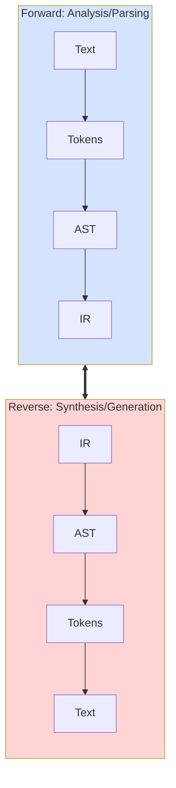

### Inverse Operations Table

| Stage | Forward (Analysis) | Reverse (Synthesis) | Roundtrip Requirement |
| ----- | ----------------- | ------------------- | -------------------- |
| **Tokenization** | Text → Tokens | Tokens → Text | Token must preserve all source info |
| **Parsing** | Tokens → AST | AST → Tokens | AST must track original syntax choices |
| **AST** | AST Construction | AST Traversal + Printing | Full position/whitespace tracking |
| **IR** | Lowering/Normalization | Code Generation | Semantic preservation, not syntax |

### Practical Reverse Patterns

#### 1. Pretty Printer (AST → Text)

```typescript
class LinkPrinter {
  visit(node: LinkNode): string {
    switch (node.type) {
      case 'wikilink':
        return node.alias 
          ? `[[${node.value}|${node.alias}]]`
          : `[[${node.value}]]`;
      case 'markdown':
        return `[${node.text}](${node.url})`;
      case 'url':
        return node.url;
    }
  }
}
```

#### 2. Code Generator (IR → Code)

```typescript
class LinkGenerator {
  generate(links: LinkNode[], template: 'wikilink' | 'markdown'): string {
    return links.map(link => {
      if (template === 'wikilink') {
        return this.toWikilink(link);
      } else {
        return this.toMarkdown(link);
      }
    }).join('\n');
  }
  
  private toWikilink(link: LinkNode): string {
    const text = link.alias || link.value;
    return `[[${link.value}|${text}]]`;
  }
}
```

#### 3. Serializer/Deserializer (IR ↔ Format)

```typescript
class LinkSerializer {
  // Forward: Parse → IR
  deserialize(text: string): LinkNode[] {
    return parseLinks(text);
  }
  
  // Reverse: IR → Text
  serialize(links: LinkNode[]): string {
    return links.map(link => link.raw || this.reconstruct(link)).join('');
  }
  
  private reconstruct(link: LinkNode): string {
    // Reconstruct original syntax or use canonical form
  }
}
```

## Design Patterns

### Patterns for Analysis (Forward)

#### 1. Scanner Pattern

```typescript
class TokenScanner {
  private pos = 0;
  
  constructor(private text: string) {}
  
  peek(): string {
    return this.text[this.pos];
  }
  
  advance(): string {
    return this.text[this.pos++];
  }
  
  scanToken(): Token | null {
    // Scan next token
  }
}
```

**Used in:** Tokenizers, lexical analysis

**Benefits:** Simple, efficient, clear control flow

#### 2. Visitor Pattern

```typescript
interface LinkVisitor<T> {
  visitWikilink(node: WikilinkNode): T;
  visitMarkdown(node: MarkdownNode): T;
  visitUrl(node: UrlNode): T;
}

class LinkValidator implements LinkVisitor<boolean> {
  visitWikilink(node: WikilinkNode): boolean {
    return node.value.length > 0;
  }
  // ... other methods
}
```

**Used in:** AST traversal, transformation, analysis

**Benefits:** Separates concerns, extensible, type-safe

**Linkity Context:**

- `visitLinks()` in `src/utils/index.ts` provides a simplified visitor
- Future: May expand to full visitor pattern if AST is adopted#### 3. Composite Pattern

```typescript
interface ASTNode {
  type: string;
  children?: ASTNode[];
  accept(visitor: Visitor): void;
}

class DocumentNode implements ASTNode {
  type = 'document';
  constructor(public children: ASTNode[]) {}
  
  accept(visitor: Visitor): void {
    visitor.visitDocument(this);
    this.children.forEach(child => child.accept(visitor));
  }
}
```

**Used in:** AST node structure

**Benefits:** Uniform interface, recursive operations, flexible tree structure

#### 4. Builder Pattern

```typescript
class LinkNodeBuilder {
  private node: Partial<LinkNode> = {};
  
  setType(type: LinkType): this {
    this.node.type = type;
    return this;
  }
  
  setValue(value: string): this {
    this.node.value = value;
    return this;
  }
  
  setPosition(start: number, end: number): this {
    this.node.position = { start, end };
    return this;
  }
  
  build(): LinkNode {
    if (!this.node.type || !this.node.value) {
      throw new Error('Invalid node');
    }
    return this.node as LinkNode;
  }
}
```

**Used in:** Complex object construction (AST nodes, IR)

**Benefits:** Fluent API, validation, immutability

### Patterns for Synthesis (Reverse)

#### 5. Template Method

```typescript
abstract class LinkFormatter {
  format(link: LinkNode): string {
    const escaped = this.escape(link.value);
    const formatted = this.applyFormat(link, escaped);
    return this.postProcess(formatted);
  }
  
  protected abstract applyFormat(link: LinkNode, value: string): string;
  
  protected escape(value: string): string {
    return value.replace(/[[\]|]/g, '\\$&');
  }
  
  protected postProcess(text: string): string {
    return text;
  }
}

class WikilinkFormatter extends LinkFormatter {
  protected applyFormat(link: LinkNode, value: string): string {
    return link.alias 
      ? `[[${value}|${link.alias}]]`
      : `[[${value}]]`;
  }
}
```

**Used in:** Code generation, pretty printing

**Benefits:** Reusable workflow, customizable steps

#### 6. Strategy Pattern

```typescript
interface LinkSerializationStrategy {
  serialize(link: LinkNode): string;
}

class WikilinkStrategy implements LinkSerializationStrategy {
  serialize(link: LinkNode): string {
    return link.alias ? `[[${link.value}|${link.alias}]]` : `[[${link.value}]]`;
  }
}

class MarkdownStrategy implements LinkSerializationStrategy {
  serialize(link: LinkNode): string {
    return `[${link.text || link.value}](${link.url})`;
  }
}

class LinkSerializer {
  constructor(private strategy: LinkSerializationStrategy) {}
  
  serialize(links: LinkNode[]): string {
    return links.map(link => this.strategy.serialize(link)).join(' ');
  }
}
```

**Used in:** Multiple output formats, configurable behavior

**Benefits:** Runtime flexibility, testable, extensible

## Current Role in Linkity

### Architecture Overview

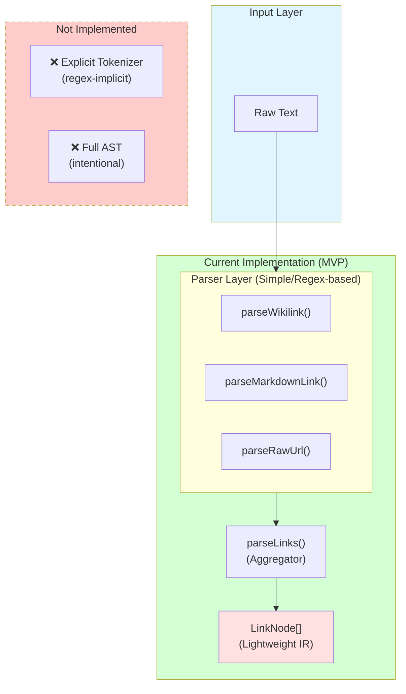

### Current Components

| Component | Type | Location | Role |
| --------- | ---- | -------- | ---- |
| **Regex-based scanners** | Implicit tokenization | Each parser file | Extract link patterns directly |
| **Link parsers** | Simple parsers | `src/parsers/*.ts` | Convert text → `LinkNode[]` |
| **LinkNode** | Lightweight IR | `src/types/index.ts` | Normalized link representation |
| **parseLinks()** | Aggregator/Router | `src/index.ts` | Coordinate multiple parsers |
| **visitLinks()** | Visitor (simplified) | `src/utils/index.ts` | Process/transform links |

### Decision: Bespoke vs. Library

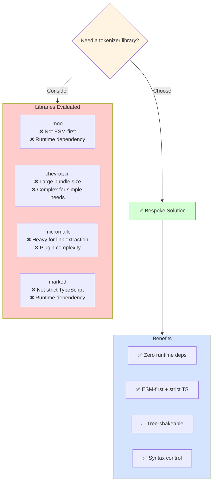

**Rationale (from `docs/ARCHITECTURE.md`):**

- **Zero runtime dependencies** → minimal bundle size
- **ESM-first and strict TypeScript** → modern tooling compatibility
- **Tree-shaking** → aggressive dead code elimination
- **Syntax control** → precise handling without over-parsing

### Why No Full AST?

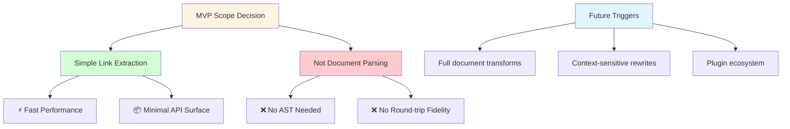

**From `docs/ARCHITECTURE.md`:**

> **MVP Scoping Decision: Simple Parser vs AST**
>
> Linkity is intentionally scoped as a simple, link-centric parser for its MVP. Rather than building a full document AST, Linkity extracts links (Markdown, wikilink, raw URL) into a normalized array of link records.

**Benefits:**

- **Performance:** Fast, low-overhead extraction
- **Simplicity:** Easier maintenance, minimal spec drift
- **Extensibility:** Stable TypeScript interface (`LinkNode`)
- **Integration:** Can plug into existing ASTs (remark, micromark)

**When to reconsider:**

- Advanced transforms or context-sensitive rewrites required
- Plugin/visitor APIs demand hierarchical document modeling
- Round-trip fidelity becomes essential

## Future Considerations

### Potential Evolution Path

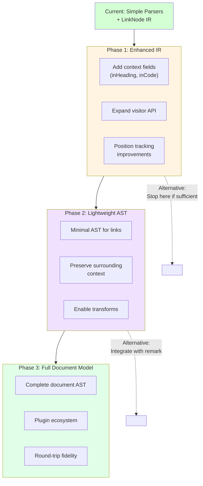

### Scenarios for Each Stage

#### Enhanced IR (Phase 1)

**Trigger:** Need for richer link metadata without full parsing

**Implementation:**

```typescript
interface LinkNode {
  type: LinkType;
  value: string;
  position: Position;
  // Enhanced context
  context?: {
    inCode?: boolean;
    inHeading?: boolean;
    headingLevel?: number;
    inline?: boolean;
    precedingText?: string;
    followingText?: string;
  };
}
```

**Use cases:**

- Conditional link processing (skip code blocks)
- Heading-aware link validation
- Context-sensitive suggestions

#### Lightweight AST (Phase 2)

**Trigger:** Need for basic transformations or context preservation

**Implementation:**

```typescript
interface LinkAST {
  type: 'Document';
  children: Array<TextNode | LinkNode | ContainerNode>;
}

interface ContainerNode {
  type: 'Heading' | 'Paragraph' | 'CodeBlock';
  level?: number;  // for headings
  children: ASTNode[];
}
```

**Use cases:**

- Link rewriting with context awareness
- Extract links with surrounding text
- Simple transformations (e.g., convert all wikilinks to markdown)

#### Full Document Model (Phase 3)

**Trigger:** Need for complete document parsing and transformation

**Implementation:**

- Adopt/integrate with **remark** or **micromark**
- Build custom AST with full Markdown support
- Implement robust visitor/plugin API

**Use cases:**

- Full Markdown IDE
- Complex transformations (e.g., refactoring, code mods)
- Round-trip editing with fidelity

### Integration Strategies

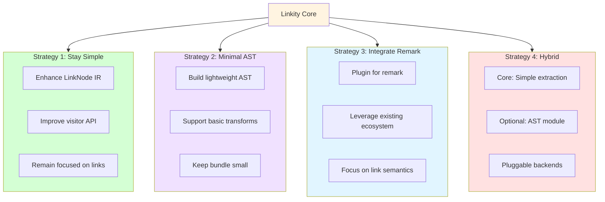

### Recommended Path

Based on Linkity's goals (zero deps, ESM-first, tree-shakeable), the recommended evolution is:

1. **Short term:** Enhance IR (Phase 1)
    - Add optional context fields to `LinkNode`
    - Expand `visitLinks()` with more capabilities
    - Maintain current simplicity

2. **Medium term:** Evaluate demand
    - Monitor user requests for AST features
    - Consider minimal AST if transforms are frequently requested
    - Stay focused on link-centric use cases

3. **Long term:** Strategic decision point
    - If full document parsing needed → **integrate with remark** (Strategy 3)
    - If staying independent → **build lightweight AST** (Strategy 2)
    - Default → **stay simple** (Strategy 1)

## Summary

### Key Takeaways

| Aspect | Current State | Future Direction |
| ------ | ------------- | ---------------- |
| **Tokenization** | Implicit (regex-based) | May formalize if complexity grows |
| **Parsing** | Simple, regex-based | Adequate for MVP; stable |
| **AST** | Not implemented | Consider if transforms needed |
| **IR** | `LinkNode` (lightweight) | Enhance with context fields |
| **Patterns** | Scanner (implicit), Visitor (simple) | May adopt Composite, Builder for AST |

### Decision Matrix

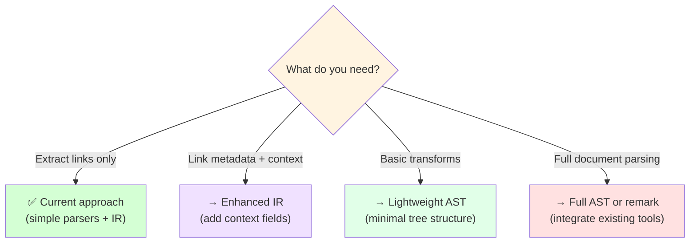

### Conclusion

Linkity's current architecture represents a **deliberate, strategic choice** to focus on **link extraction** rather than full document parsing. The use of simple, regex-based parsers with a lightweight IR (`LinkNode`) provides:

- ✅ **Performance:** Fast, low-overhead
- ✅ **Simplicity:** Easy to maintain and extend
- ✅ **Flexibility:** Stable API, can integrate with other tools
- ✅ **Bundle size:** Zero runtime deps, tree-shakeable

Future evolution toward tokenizers, AST, or more sophisticated IR should be **driven by concrete user needs**, not architectural speculation. The MVP scope provides a solid foundation that can evolve incrementally without breaking existing contracts.

**For now, Linkity's approach is:** Parse what matters (links), normalize the output (`LinkNode`), and leave document structure to other tools (remark, micromark) if needed.

---

## References

- `docs/ARCHITECTURE.md` — MVP scoping decision and tokenizer rationale
- `CONTRIBUTING.md` — Parser development guidelines
- `src/types/index.ts` — `LinkNode` interface definition
- `src/parsers/*.ts` — Current parser implementations
- `src/utils/tokenize.ts` — Wikilink tokenizer prototype
